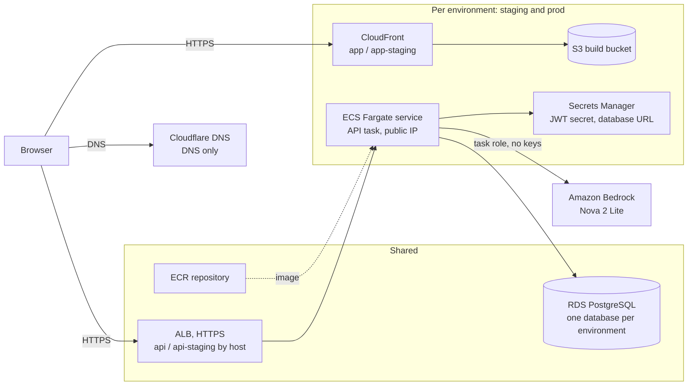

# AWS architecture

Everything runs in one AWS account in **us-east-1**. DNS stays on Cloudflare (DNS only, no proxy, no Route 53
hosted zone). Why the load balancer and the database are shared:
[ADR-0003](../adr/0003-share-the-load-balancer-and-database-between-environments.md).

## Network (no NAT Gateway)

| Subnets | Contents | Route to the internet |
|---|---|---|
| Public (10.40.0.0/24, 10.40.1.0/24) | ALB, API tasks (with public IPs) | Internet gateway |
| Isolated (10.40.10.0/24, 10.40.11.0/24) | RDS | None |

- The tasks reach AWS APIs (Bedrock, ECR, Secrets Manager, CloudWatch) over HTTPS through the internet gateway,
  instead of a NAT Gateway (about USD 33/month) or interface endpoints (USD 7.30/month each per AZ).
  S3 traffic, including ECR image layers, uses the free gateway endpoint.
- **Security groups:** the ALB accepts 443 and 80 (redirect) from the internet and sends traffic only to the
  tasks' port. Each environment's tasks accept port 8000 only from the ALB and send only 443 (anywhere) and 5432
  (database). The database accepts 5432 only from the tasks' security groups.
- The default security group of the VPC has no rules. Flow logs record rejected traffic for 14 days.

## API

- ECS Fargate, 0.25 vCPU and 0.5 GB, x86_64, read-only root file system, public IP, circuit breaker with rollback.
- Uvicorn runs with `--proxy-headers`, so the rate limits see the client IP from the ALB's `X-Forwarded-For`.
  This is safe because only the ALB can reach the tasks.
- The ALB checks `/ready` (database included) and keeps idle connections for 300 seconds, so streamed
  generation is not cut off.
- Configuration: `ENVIRONMENT`, `CORS_ORIGINS` (the environment's app URL), `AI_PROVIDER=bedrock`,
  `BEDROCK_MODEL_ID`, `BEDROCK_REGION`; secrets `JWT_SECRET` and `DATABASE_URL` from Secrets Manager.
- **Bedrock without keys:** the task role may call `InvokeModel` and `InvokeModelWithResponseStream` on the
  inference profile `us.amazon.nova-2-lite-v1:0`, and on the Nova 2 Lite foundation model in the three regions the
  profile routes to (us-east-1, us-east-2, us-west-2), only when the call comes through that profile.

## Database

- RDS PostgreSQL 17, db.t4g.micro, 20 GB gp3 (autoscaling to 50 GB), encrypted, Single-AZ, 7 days of backups,
  deletion protection, a final snapshot on deletion, TLS required (`rds.force_ssl=1`), logs exported to CloudWatch.
- The master password is created and stored by RDS in Secrets Manager and is never seen by Terraform.
- Each environment's apply runs a one-off Fargate task (`psql`) that creates its role and database idempotently
  (`silver_app_<env>`, `silver_proposals_<env>`) and revokes `CONNECT` from `PUBLIC`.

## Frontend

- Private S3 bucket (public access blocked, ACLs disabled, versioning, TLS-only), read only by CloudFront through
  Origin Access Control.
- CloudFront with the managed `CachingOptimized` cache policy and `SecurityHeadersPolicy`, TLS 1.2+, HTTP/2 and
  HTTP/3, and `index.html` for unknown paths so the single-page app's routes work.

## Certificates and DNS

| Record | Points to | Certificate |
|---|---|---|
| `api.silversoft.com.br`, `api-staging.silversoft.com.br` | ALB | one ACM certificate on the shared listener |
| `app.silversoft.com.br`, `app-staging.silversoft.com.br` | each environment's CloudFront | one ACM certificate per environment |

ACM validation records are created in Cloudflare by Terraform. All records are DNS only (proxy off).

## Costs and budget

About USD 66/month for both environments with the API running (see ADR-0003). The AWS Budget alerts at 80% and
100% of USD 40 actual cost and at 100% forecast; with both environments running all month, the alert is expected
to fire, and the AWS credits cover the spend.
