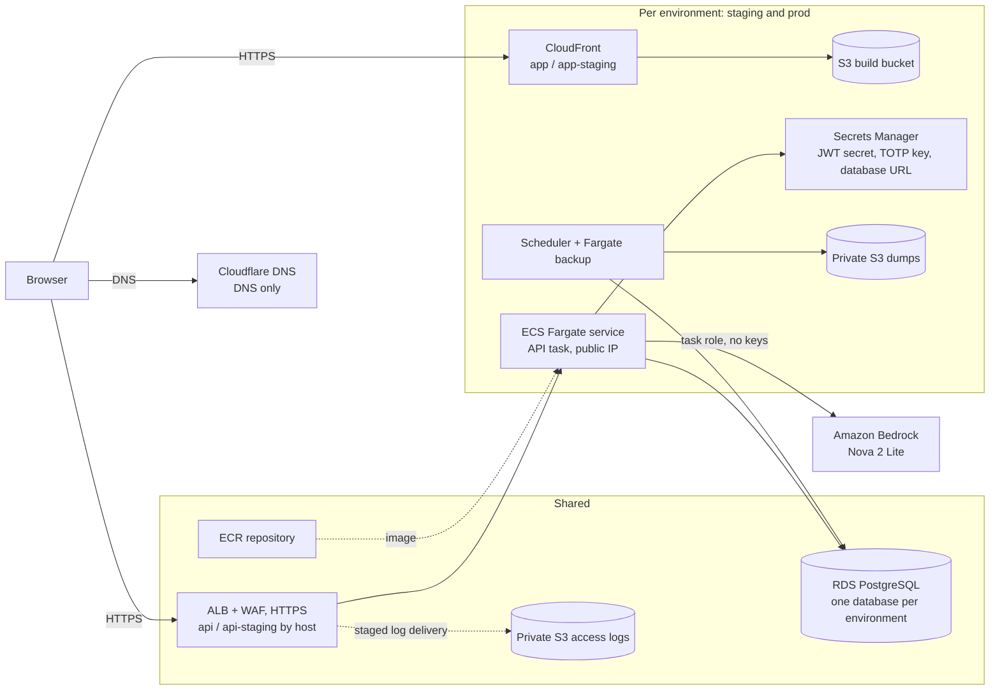

# AWS architecture

Everything runs in one AWS account in **us-east-1**. DNS stays on Cloudflare (DNS only, no proxy, no Route 53
hosted zone). Why the load balancer and the database are shared:
[ADR-0003](../adr/0003-share-the-load-balancer-and-database-between-environments.md).

## Network (no NAT Gateway)

| Subnets | Contents | Route to the internet |
|---|---|---|
| Public (10.40.0.0/24, 10.40.1.0/24) | ALB, API tasks (with public IPs) | Internet gateway |
| Isolated (10.40.10.0/24, 10.40.11.0/24) | RDS | None |

- The tasks reach AWS APIs (Bedrock, ECR, Secrets Manager, CloudWatch) over HTTPS through the internet gateway,
  instead of a NAT Gateway (about USD 33/month) or interface endpoints (USD 7.30/month each per AZ).
  S3 traffic, including ECR image layers, uses the free gateway endpoint.
- **Security groups:** the ALB accepts 443 and 80 (redirect) from the internet and sends traffic only to the
  tasks' port. Each environment's tasks accept port 8000 only from the ALB and send only 443 (anywhere) and 5432
  (database). The database accepts 5432 only from the tasks' security groups.
- The default security group of the VPC has no rules. Flow logs record rejected traffic for 14 days.

## API

- ECS Fargate, 0.25 vCPU and 1 GB (the API plus the collector sidecar), x86_64, read-only root file system, public IP, circuit breaker with rollback.
- Uvicorn runs with `--proxy-headers` and trusts forwarded headers only from the VPC CIDR (the ALB), so the rate limits see
  the client IP the ALB appends to `X-Forwarded-For`. With `*`, Uvicorn would take the leftmost entry, which the client sets.
  This is safe because only the ALB can reach the tasks.
- The ALB checks `/ready` (database included) and keeps idle connections for 300 seconds, so streamed
  generation is not cut off.
- Configuration: `ENVIRONMENT`, `CORS_ORIGINS` (the environment's app URL), `AI_PROVIDER=bedrock`,
  `BEDROCK_MODEL_ID`, `BEDROCK_REGION`; secrets `JWT_SECRET`, `TOTP_ENCRYPTION_KEY`, and `DATABASE_URL` from Secrets Manager.
- **Bedrock without keys:** the task role may call `InvokeModel` and `InvokeModelWithResponseStream` on the
  inference profile `us.amazon.nova-2-lite-v1:0`, and on the Nova 2 Lite foundation model in the three regions the
  profile routes to (us-east-1, us-east-2, us-west-2), only when the call comes through that profile.

## Database

- RDS PostgreSQL 17, db.t4g.micro, 20 GB gp3 (autoscaling to 50 GB), encrypted, Single-AZ, one day of automated snapshots,
  deletion protection, a final snapshot on deletion, TLS required (`rds.force_ssl=1`), logs exported to CloudWatch.
- The master password is created and stored by RDS in Secrets Manager and is never seen by Terraform.
- Each environment's apply runs a one-off Fargate task (`psql`) that creates its role and database idempotently
  (`silver_app_<env>`, `silver_proposals_<env>`) and revokes `CONNECT` from `PUBLIC`. Only the setup execution role can read the master secret.
- Scheduler starts a daily logical dump per environment. S3 retains each dump for 14 days. [Restore a database backup](../runbooks/database-restore.md).

## Frontend

- Private S3 bucket (public access blocked, ACLs disabled, versioning, TLS-only), read only by CloudFront through
  Origin Access Control.
- CloudFront with the managed `CachingOptimized` cache policy and `SecurityHeadersPolicy`, TLS 1.2+, HTTP/2 and
  HTTP/3, and `index.html` for unknown paths so the single-page app's routes work.

## Certificates and DNS

| Record | Points to | Certificate |
|---|---|---|
| `api.silversoft.com.br`, `api-staging.silversoft.com.br` | ALB | one ACM certificate on the shared listener |
| `app.silversoft.com.br`, `app-staging.silversoft.com.br` | each environment's CloudFront | one ACM certificate per environment |

ACM validation records are created in Cloudflare by Terraform. All records are DNS only (proxy off).

## Observability

- **Logs:** the API writes JSON lines (request ID, route template, status, duration, trace ID) to
  `/ecs/silver-proposals-<env>-api`, using route templates to keep share tokens out of application request logs. The staged ALB access logging configuration delivers raw request lines to a private S3 archive for 184 days. [Security hardening rollout](../runbooks/security-hardening.md).
- **Traces:** an AWS Distro for OpenTelemetry collector sidecar in each task forwards the API's OpenTelemetry traces
  to AWS X-Ray. The task role may only write traces.
- **Metrics:** ALB, ECS, RDS, and CloudFront metrics, plus metrics from log filters (generations, failures, Bedrock
  latency, errors).
- **Dashboards and alarms:** one dashboard per environment and alarms on health, errors, latency, resources, and
  generation failures, all notifying one SNS topic by e-mail. See [Monitoring](../reference/monitoring.md).
- **Health checks:** the ALB checks `/ready` (database included) and ECS checks `/health` inside the container.

## Costs and budget

About USD 66/month for both environments with the API running (see ADR-0003), plus about USD 5/month of
observability and USD 8/month for the WAF on the API load balancer (USD 5 per ACL and USD 1 per rule, three rules),
about USD 79/month in total. The CloudFront distributions have no WAF: they serve only static files, and two more
ACLs would cost USD 16/month. The AWS Budget is an overrun alert, not the expected cost: it fires at 80% (USD 92)
and 100% (USD 115) of actual cost and at 100% of the forecast, so it stays silent in normal operation and warns when
the spend grows about 16% or more above the estimate (for example, abuse of AI generation or a resource left
running).
